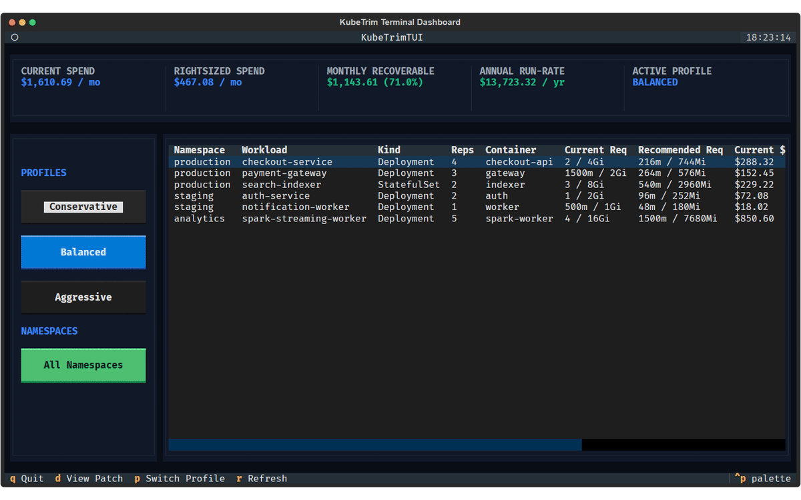
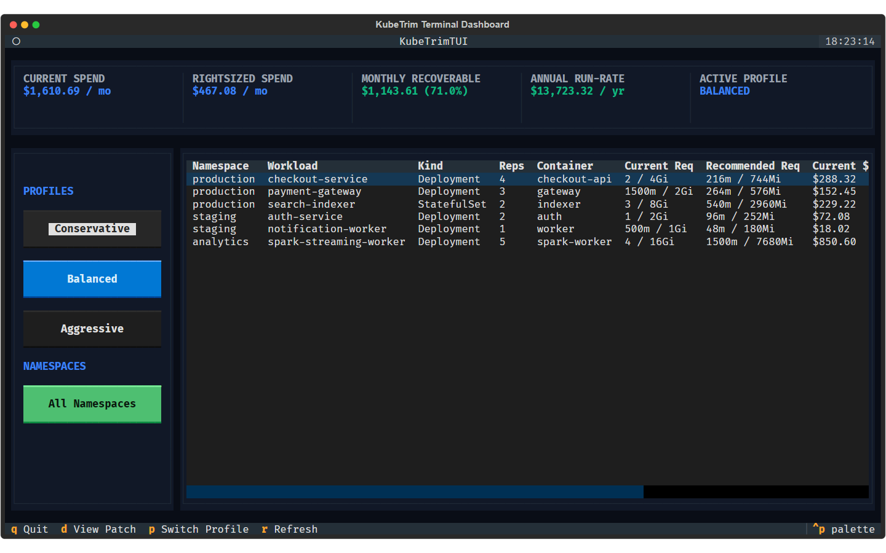
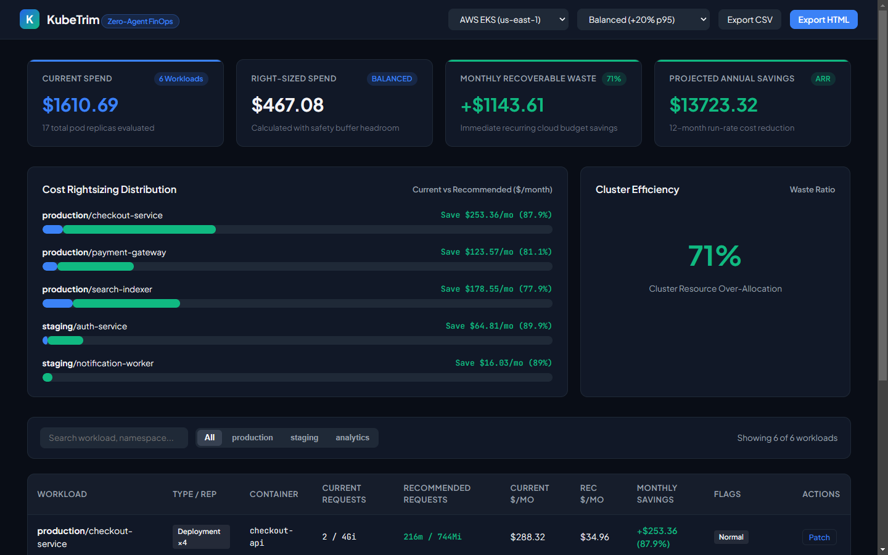
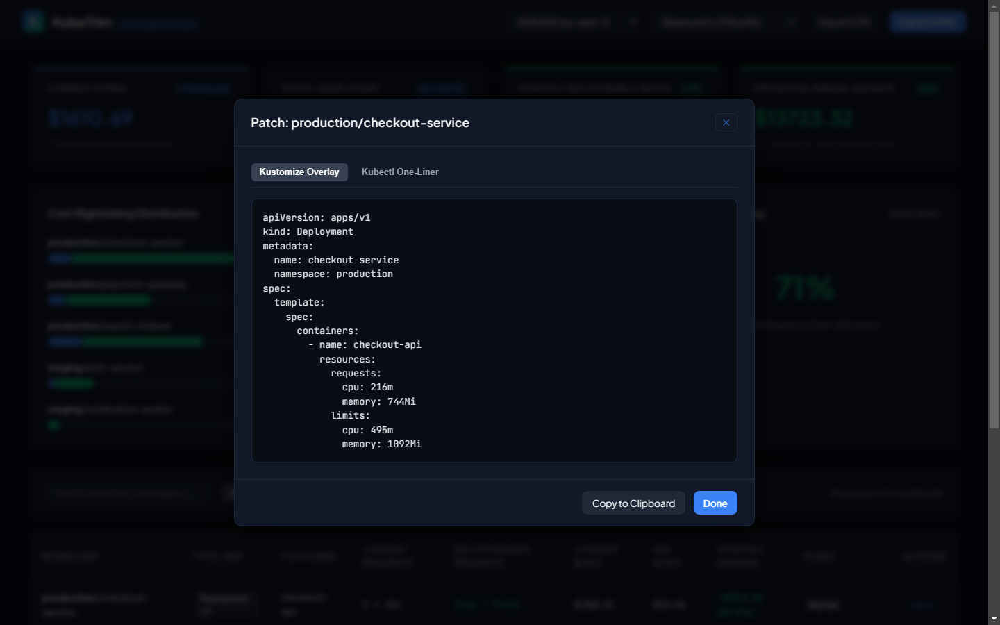
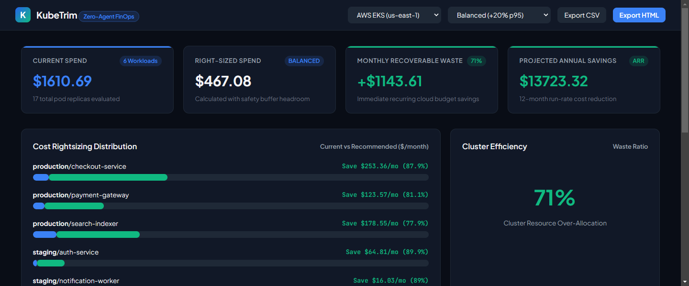

<p align="center">
  
</p>

<h1 align="center">KubeTrim</h1>

<p align="center">
  Zero-agent Kubernetes FinOps and pod rightsizing patch generator analyzing historical p95/p99 metrics and cloud costs
</p>

<p align="center">
  <a href="https://github.com/alexandrmotologa/kubetrim/actions"></a>
  <a href="https://pypi.org/project/kubetrim"></a>
  <a href="LICENSE"></a>
  <a href="https://python.org"></a>
</p>

---

Kubernetes workloads are frequently over-provisioned during initial rollout. Teams configure generous CPU and memory requests to prevent out-of-memory crashes and CPU throttling. Because cloud managed clusters schedule worker nodes based on total resource requests, unused allocations generate significant recurring costs.

Existing cost management solutions often demand cluster-admin agents, privileged daemonsets, or external software-as-a-service subscriptions.

KubeTrim runs locally or in CI pipelines without installing cluster agents. It reads workload specifications via standard kubeconfig, queries Prometheus or Kubernetes Metrics Server for historical p90, p95, and p99 utilization metrics, applies safety buffer heuristics, computes dollar waste using real AWS, GCP, and Azure pricing models, and generates unified git diffs, Helm values overrides, and Kustomize patches.

## Demonstration



### Interface Walkthrough

| Interactive Textual TUI Dashboard | Real-Time Cluster FinOps Web Studio |
| :---: | :---: |
|  |  |

| Unified Diff and Helm Patch Inspector | Namespace Waste Analysis and Cost Breakdown |
| :---: | :---: |
|  |  |

---

## Core Capabilities

- **Zero-agent architecture**: Operates in read-only mode using existing `~/.kube/config` credentials. No cluster controllers, webhooks, or node daemonsets required.
- **Historical metric aggregation**: Evaluates PromQL time-series data over customizable timeframes (7d, 14d, 30d) for p90, p95, and p99 percentiles, with fallback to Kubernetes Metrics Server (`metrics.k8s.io`).
- **Cloud cost calculation engine**: Ships with pricing catalogs for AWS EKS, GCP GKE, Azure AKS, and bare-metal infrastructure, tracking per-vCPU and per-gigabyte hourly rates.
- **Safety headroom heuristics**: Configurable profiles (`conservative`, `balanced`, `aggressive`) add safety buffers to prevent OOMKills and throttling while lowering idle capacity.
- **OOMKill mitigation guard**: Detects historical container crash events and automatically applies elevated memory safety floors.
- **Actionable GitOps patches**: Emits ready-to-commit unified diffs for Kubernetes Deployment and StatefulSet manifests, in-place Helm `values.yaml` patches, and Kustomize overlays.
- **Dual visual interfaces**: Includes an interactive terminal user interface (Textual TUI) and a browser-based FinOps Web Studio (FastAPI).
- **Automated CI budget gates**: Enforces maximum allowable waste thresholds in pull requests with exit code signaling.

---

## Architecture

```
                      +---------------------------------------+
                      |         KubeTrim CLI / TUI / Web      |
                      +-------------------+-------------------+
                                          |
                 +------------------------+------------------------+
                 |                                                 |
+----------------v----------------+               +----------------v---------------+
|    Kubernetes Client Engine     |               |    Metrics Ingestion Layer     |
|  * Read-only kubeconfig context |               |  * Prometheus PromQL Evaluator |
|  * Deployments, StatefulSets    |               |  * Metrics Server API fallback |
|  * Configured requests & limits |               |  * OOMKill historical detector |
+----------------+----------------+               +----------------+---------------+
                 |                                                 |
                 +------------------------+------------------------+
                                          |
                        +-----------------v-----------------+
                        |     FinOps Calculation Engine     |
                        |  * Cloud rate cards (AWS/GCP/AKS) |
                        |  * Configurable safety buffers    |
                        |  * Dollar savings and run-rate    |
                        +-----------------+-----------------+
                                          |
                        +-----------------v-----------------+
                        |      Patch & Export Generator     |
                        |  * Unified YAML git diffs         |
                        |  * Helm values.yaml updates       |
                        |  * Kustomize resource patches     |
                        |  * JSON, CSV, and HTML reports    |
                        +-----------------------------------+
```

---

## Installation

### Via pip

```bash
pip install kubetrim
```

### From source

```bash
git clone https://github.com/alexandrmotologa/kubetrim.git
cd kubetrim
python -m venv .venv
source .venv/bin/activate  # On Windows: .\.venv\Scripts\activate
pip install -e ".[dev]"
```

---

## Quickstart

### 1. Scan a cluster or namespace

Scan all workloads in the default namespace using AWS us-east-1 pricing and the balanced profile:

```bash
kubetrim scan --namespace default --provider aws
```

### 2. Generate unified YAML diffs

Generate patch diffs for local deployment manifests:

```bash
kubetrim diff --manifest ./manifests/deployment.yaml
```

### 3. Patch Helm values.yaml in-place

Update `resources` blocks in a Helm chart values file with rightsized recommendations:

```bash
kubetrim patch --helm-values ./charts/my-app/values.yaml --write
```

### 4. Launch the Interactive Textual TUI

```bash
kubetrim tui
```

### 5. Launch the Web Studio Dashboard

```bash
kubetrim web --port 8980
```

Open `http://localhost:8980` in your browser.

---

## Rightsizing Profiles

KubeTrim provides pre-configured profiles under `configs/profiles/`:

| Profile | Target Percentile | CPU Buffer | Memory Buffer | Target Workload |
| :--- | :---: | :---: | :---: | :--- |
| `conservative` | p99 | +40% | +40% | Mission-critical core services |
| `balanced` | p95 | +20% | +20% | General production applications |
| `aggressive` | p90 | +10% | +10% | Development, staging, and batch jobs |

You can also pass custom parameters:

```bash
kubetrim scan --buffer-cpu 0.25 --buffer-memory 0.30 --min-cpu 0.05
```

---

## Cloud Pricing Reference

Default hourly rates per vCPU and GB RAM are loaded from `configs/pricing/`:

- **AWS EKS (us-east-1)**: \$0.04048 / vCPU-hour, \$0.004445 / GB-hour
- **GCP GKE (us-central1)**: \$0.03350 / vCPU-hour, \$0.004490 / GB-hour
- **Azure AKS (eastus)**: \$0.03800 / vCPU-hour, \$0.005100 / GB-hour
- **Bare-metal / Custom**: User-specified rate cards

---

## Development & Testing

Run tests and verification:

```bash
pytest
```

Run test suite with coverage report:

```bash
pytest --cov=kubetrim --cov-report=term-missing
```

---

## License

This project is licensed under the MIT License. See [LICENSE](LICENSE) for details.
